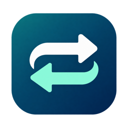

# FileBridge



Windows 与 macOS 之间的文件传输工具，支持暂停续传、并行分块和 SHA-256 校验。
A desktop file transfer app for Windows and macOS, with pause/resume, parallel chunks and SHA-256 verification.

[中文](#中文) · [English](#english) · [所有下载 / All releases](https://github.com/samhu70/FileBridge/releases)

## 下载 / Downloads

| 平台 / Platform | 版本 / Version | 下载 / Download |
| --- | --- | --- |
| Windows x64 | 2.5.1 | [Windows ZIP](https://github.com/samhu70/FileBridge/releases/download/v2.5.1/FileBridge-windows-x64-2.5.1-framework-dependent.zip) |
| macOS Apple Silicon (arm64) | 2.5.1 | [macOS ZIP](https://github.com/samhu70/FileBridge/releases/download/v2.5.1/FileBridge-macOS-arm64-2.5.1-framework-dependent.zip) |
| SHA-256 | 2.5.1 | [SHA256SUMS](https://github.com/samhu70/FileBridge/releases/download/v2.5.1/SHA256SUMS-2.5.1.txt) |

**2.5.1 新增支持开发入口**：软件窗口底部和本页均提供自愿打赏链接，中英文界面同步切换。发布包由 `v2.5.1` 标签对应源码构建。

**2.5.1 adds an optional support link** in the app footer and this README, with Chinese and English text. Downloads are built from `v2.5.1`.

**2.5.1 同版本更新（2026-11-01）**：修复英文「Send files / Receive files」页签文字显示不完整的问题，版本号保持不变。已下载旧包的用户请重新下载并替换客户端。

**2.5.1 package refresh (2026-11-01):** fixed clipped **Send files / Receive files** tab labels in English. The version remains unchanged; download the refreshed package to replace an earlier copy.

## 中文

### 支持开发

如果 FileBridge 对你有帮助，欢迎[通过 Stripe 自愿打赏](https://buy.stripe.com/7sYeVcawk5hIb6JfSP1oI00)，支持持续开发与维护。一次性打赏，以澳元计价，建议 A$5，金额可自行修改。软件窗口底部也提供「支持 FileBridge」入口。

### 软件功能

- **跨平台传输**：在 Windows 与 macOS 之间发送文件或整个文件夹，支持中文文件名和目录。
- **无需应用账号**：FileBridge 本身无需注册；通过局域网、Tailscale 或其他已连通的 VPN 传输，不依赖 FileBridge 中转服务器。
- **连接码配对与保留**：发送端记住输入；接收端保存认证凭据、地址、端口和目录，重启后可继续沿用。两端均提供手动更换入口。
- **暂停与断点续传**：暂停、网络中断或接收端重启后，可从已校验的连续位置恢复。接收端重启可沿用仍有效的原连接码。
- **并行分块**：发送端可选 1–10 路上限，默认 4 路。文件不超过 4 MiB 时自动单路；更大文件按分块数、用户上限和对端能力取较小值。例如默认上限下，6 MiB 用 2 路，20 MiB 用 4 路。
- **完整性校验**：每块 4 MiB，分块和最终文件都校验 SHA-256；续传时也检查已有数据。
- **同名文件保护**：不覆盖已有的不同内容文件；内容一致的成品自动跳过。
- **HTTPS 连接**：长期码固定接收端公钥与随机令牌；TLS 证书保持有效期校验，并用同一密钥自动续签，连接码不变。
- **双语界面**：中文 / English 即时切换并记住选择，显示收发进度、速度、当前文件剩余时间与并行状态。

### 运行要求

下载包为 **framework-dependent 精简包**，不含 .NET 运行时。请先安装与系统架构匹配的：

- .NET 10 Runtime (`Microsoft.NETCore.App 10.0.x`)；
- ASP.NET Core 10 Runtime (`Microsoft.AspNetCore.App 10.0.x`)。

安装同架构的 .NET 10 SDK 也满足要求。仅安装 .NET Desktop Runtime 不代表已包含 ASP.NET Core。下载入口：[.NET 10 官方下载](https://dotnet.microsoft.com/en-us/download/dotnet/10.0)。

Windows 解压后打开 `FileBridge.exe`；Mac 解压后打开 `FileBridge.app`。请保留解压后的完整目录，不能只复制一个可执行文件。

### 快速开始

1. 确认双方电脑位于可互通的局域网，或已通过 Tailscale / VPN 连通。
2. 接收方打开「接收文件」，确认接收 IP、端口（默认 `8787`）和保存位置，点击「开始接收」。
3. 接收方点击「复制连接码」，只把连接码交给预期发送方。
4. 发送方选择文件或文件夹，粘贴完整连接码，选择并发上限，点击「开始发送」。
5. 需要中断时点击「暂停」；恢复时点击「继续发送」。以「校验通过」作为完成标准。

接收端重启后，点击「开始接收」即可沿用原连接码；发送方重新选择原文件即可续传。不要删除保存目录下的 `.filebridge-parts`。

### 连接码的保存与更换

- **发送端**：输入自动保存。点击「更换连接码」并粘贴新的接收端连接码；发送期间不能更换。
- **接收端**：重启恢复地址、端口、保存目录和连接码，但不会自动开始监听。点击「开始接收」后沿用旧码。
- **手动换码**：先停止接收，再点击「重新创建连接码」，然后开始接收并分享新码。旧码失效，断点数据保留。
- **长期使用**：地址、端口和本地凭据不变时，长期码没有日历到期时间。证书续签、停止接收或重启都不会更换公钥身份或令牌。损坏凭据会提示手动处理，不自动替换。
- **从旧版升级**：旧 `fb2_` 码不会被自动改写，仍按旧证书有效期使用；手动重新创建一次即可得到 `fb3_` 长期码。长期码要求收发两端均升级至 2.5.0 或更新版本。没有保存过的旧凭据无法恢复。
- 连接信息保存在当前用户的本地应用数据目录 `FileBridge/connections.json`。该文件含访问令牌和证书私钥，不要分享或上传。Unix 使用文件 `0600`、目录 `0700`；Windows 使用用户配置目录的继承权限。
- 共用配置的其他窗口不能同时启动接收或重新创建凭据，以免旧监听仍使用已经更换的身份。

### 使用边界

- 自动优先选择 Tailscale 地址，其次为局域网私有 IPv4；只有 `127.0.0.1` 时仅能本机测试。
- 软件不提供 NAT 穿透或公网中转，不配置 VPN、防火墙或 Tailscale 权限；选中的 IP 和端口必须能从对端访问。
- 不传输空目录或符号链接；接收目录及其内部路径不能使用符号链接或目录联接。
- 传输期间不要修改源文件或临时文件。多个文件按顺序发送，并行针对单个文件的分块，不保证在所有网络上提速。
- 当前发布包没有 Apple Developer ID 公证或 Windows Authenticode 签名。

### 从当前 main 源码构建

使用 C# / .NET 10、ASP.NET Core Kestrel 和 Avalonia 12.1.4。

```sh
dotnet build FileBridge.sln -c Release
dotnet run --project FileBridge.Tests -c Release
dotnet run --project FileBridge.Desktop -c Release
```

可选测试：`dotnet run --project FileBridge.Tests -c Release -- --ui` 需要图形会话，会自动打开并关闭测试窗口；`--large` 会创建并传输 2 GiB 文件，验证暂停恢复和 SHA-256。

### 仓库访问

本仓库公开，便于浏览源码和直接下载 Release。公开可读不等于公开可写：访客可以下载、Fork 或提交 Pull Request，但不能直接推送或合并到本仓库；写权限仅授予仓库所有者及其明确授权的协作者。当前未添加协作者。

## English

### Support development

If FileBridge is useful to you, you can [leave an optional tip through Stripe](https://buy.stripe.com/7sYeVcawk5hIb6JfSP1oI00) to support ongoing development and maintenance. Tips are one-time payments in AUD, with a suggested A$5 that you can change. You can also select **Support FileBridge** at the bottom of the app window.

### Features

- **Cross-platform transfers** between Windows and macOS, including entire folders and Unicode file names.
- **No FileBridge account required.** Transfer over a reachable LAN, Tailscale or another VPN, without a FileBridge relay server.
- **Saved connection codes:** the sender remembers its input, and the receiver keeps its credentials, address, port and destination across restarts. Both ends provide a manual change entry.
- **Pause and resume** after a pause, network interruption or receiver restart, starting from the verified contiguous prefix. A receiver restart can reuse the existing valid connection code.
- **Parallel chunks:** choose a limit of 1–10 streams, default 4. Files up to 4 MiB use one stream. Larger files use the minimum of their chunk count, your limit and the receiver capability. With the default limit, 6 MiB uses 2 streams and 20 MiB uses 4.
- **SHA-256 verification** for each 4 MiB chunk, the resumed prefix and the completed file.
- **Existing-file protection:** different contents are never overwritten; already-completed files with matching contents are skipped.
- **HTTPS transport** with a persistent public-key pin and random token. TLS certificate dates remain checked; same-key certificate renewal leaves the long-lived code unchanged.
- **Chinese and English UI** with a saved language preference, transfer progress, speed, time remaining for the current file and negotiated parallel mode.

### Requirements

The downloads are **framework-dependent** and do not include .NET. Install both the **.NET 10 Runtime** and **ASP.NET Core 10 Runtime**, matching your system architecture. A matching .NET 10 SDK also provides both. The .NET Desktop Runtime alone is not sufficient.

Download them from the [official .NET 10 download page](https://dotnet.microsoft.com/en-us/download/dotnet/10.0).

On Windows, extract the ZIP and open `FileBridge.exe`. On Mac, extract the ZIP and open `FileBridge.app`. Keep the entire extracted directory together.

### Quick start

1. Connect both computers over a reachable LAN, Tailscale or another VPN.
2. On the receiver, open **Receive files**, check the local IP, port (default `8787`) and destination folder, then select **Start receiving**.
3. Copy the connection code and share it only with the intended sender.
4. On the sender, choose files or a folder, paste the complete code, choose the stream limit and select **Start sending**.
5. Select **Pause** when needed and **Continue sending** to resume. Wait for checksum verification before treating a file as complete.

After restarting the receiver, select **Start receiving** to reuse the saved code. Select the original source files again to resume. Keep the `.filebridge-parts` directory.

### Saved codes and manual changes

- **Sender:** input is saved automatically. Select **Change code** and paste the new receiver code. Changes are disabled during sending.
- **Receiver:** the code, address, port and destination are restored. Restoring them does not start a listener; select **Start receiving** first.
- **Manual recreation:** stop receiving, select **Recreate code**, then start receiving and share the new code. The old code becomes invalid; partial files are kept.
- Long-lived codes have no calendar expiration while their endpoint and local credentials stay the same. TLS renewal and app restarts do not rotate the public key or token. Damaged credentials require manual recreation and are never replaced silently.
- Existing `fb2_` codes are not automatically rewritten and retain their old certificate validity. Manually recreate once to obtain a long-lived `fb3_` code. Both peers must use 2.5.0 or newer for long-lived codes. Credentials that an old version never saved cannot be recovered.
- Details are stored in `FileBridge/connections.json` under the current user's local application data folder. This file contains access tokens and a certificate private key: do not share or upload it. Unix permissions are `0600` for the file and `0700` for its directory; Windows inherits the user profile directory permissions.
- App instances sharing the same profile cannot receive or recreate credentials simultaneously, so a code change cannot leave another profile listener using an old identity.

### Limits

- Address discovery prefers Tailscale, then a private LAN IPv4 address. `127.0.0.1` works only on the same computer.
- FileBridge does not provide NAT traversal or a public relay, and does not configure VPN access or firewalls. The selected IP and port must already be reachable.
- Empty folders and symbolic links are not transferred. Receive paths must not contain symbolic links or directory junctions.
- Do not modify source or partial files during a transfer. Files are sent sequentially; parallelism applies to chunks within a file and does not guarantee faster transfers on every network.
- The current packages are not notarized with Apple Developer ID or signed with Windows Authenticode.

### Build the current main branch

Requires the .NET 10 SDK. The app uses C#, ASP.NET Core Kestrel and Avalonia 12.1.4.

```sh
dotnet build FileBridge.sln -c Release
dotnet run --project FileBridge.Tests -c Release
dotnet run --project FileBridge.Desktop -c Release
```

Optional: add `-- --ui` to the test command for native desktop regression checks in a graphical session, or `-- --large` for an actual 2 GiB transfer with pause/resume and checksum verification.

### Repository layout

```text
FileBridge.Core/       Transfer protocol, validation, sender and receiver
FileBridge.Desktop/    Avalonia UI, localization and application assets
FileBridge.Tests/      Protocol, transfer and desktop regression checks
ThirdPartyNotices/     Third-party library notices
```

The Git repository contains source, required application assets and notices. Local planning documents, design history, build output and release binaries are excluded. Installable downloads are distributed through **GitHub Releases**.

### Repository access

This repository is public for source browsing and release downloads. Visitors may download, fork or submit a pull request, but cannot push or merge directly into this repository. Write access is limited to the owner and explicitly authorized collaborators. No collaborators have been added.

[Third-party notices](ThirdPartyNotices/README.txt)
