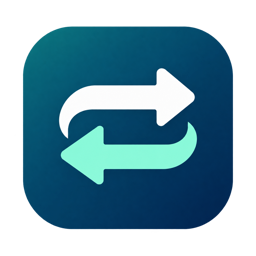

# FileBridge



Windows 与 macOS 之间的文件传输工具，支持暂停续传、并行分块和 SHA-256 校验。
A desktop file transfer app for Windows and macOS, with pause/resume, parallel chunks and SHA-256 verification.

[中文](#中文) · [English](#english) · [所有下载 / All releases](https://github.com/samhu70/FileBridge/releases)

## 下载 / Downloads

| 平台 / Platform | 版本 / Version | 下载 / Download |
| --- | --- | --- |
| Windows x64 | 2.5.11 | [Windows ZIP](https://github.com/samhu70/FileBridge/releases/download/v2.5.11/FileBridge-windows-x64-2.5.11-framework-dependent.zip) |
| macOS Apple Silicon (arm64) | 2.5.11 | [macOS ZIP](https://github.com/samhu70/FileBridge/releases/download/v2.5.11/FileBridge-macOS-arm64-2.5.11-framework-dependent.zip) |
| SHA-256 | 2.5.11 | [SHA256SUMS](https://github.com/samhu70/FileBridge/releases/download/v2.5.11/SHA256SUMS-2.5.11.txt) |

**2.5.11：同一个连接码，优先直连、失败后走公网。** 接收方可选启用 Tailscale Funnel 公网备用入口，公网发送方无需 Tailscale；两条通道共用认证令牌与 TLS 公钥校验，支持断点续传。停止接收或退出会撤销本窗口的临时公网入口，保留已有服务。继续包含 Windows 首次建码修复、多实例空闲端口选择和长期连接码。Mac 与 Windows 原包均在本地构建和验证，未使用 GitHub Actions；源码对应 `v2.5.11`。

**2.5.11: one code, direct access first, public fallback when needed.** The receiver can enable an optional Tailscale Funnel entry; public senders do not need Tailscale. Both routes share the token and TLS public-key pin and support verified resume. Stopping reception or exiting removes this window's temporary entry while preserving other services. Windows first-time code creation fixes, available-port selection and long-lived codes remain included. Both archives were built and tested locally without GitHub Actions, from `v2.5.11`.

## 中文

### 支持开发

如果 FileBridge 对你有帮助，欢迎通过 [Stripe](https://buy.stripe.com/7sYeVcawk5hIb6JfSP1oI00) 或 [PayPal](https://paypal.me/samhu70) 自愿打赏，支持持续开发与维护。金额可自行选择；Stripe 为一次性澳元打赏，建议 A$5，金额可修改。软件窗口底部的「支持 FileBridge」旁也提供 Stripe 和 PayPal 两个入口。

### 软件功能

- **跨平台传输**：在 Windows 与 macOS 之间发送文件或整个文件夹，支持中文文件名和目录。
- **无需应用账号**：FileBridge 本身无需注册；通过局域网、Tailscale 或其他已连通的 VPN 传输，不依赖 FileBridge 中转服务器。
- **连接码配对与保留**：首次进入接收页自动创建缺少的连接码；发送端记住输入，接收端保存认证凭据、地址、端口和目录，重启后可继续沿用。两端均提供手动更换入口。
- **暂停与断点续传**：暂停、网络中断或接收端重启后，可从已校验的连续位置恢复。接收端重启可沿用仍有效的原连接码。
- **并行分块**：发送端可选 1–10 路上限，默认 4 路。文件不超过 4 MiB 时自动单路；更大文件按分块数、用户上限和对端能力取较小值。例如默认上限下，6 MiB 用 2 路，20 MiB 用 4 路。
- **完整性校验**：普通上传每块 4 MiB；新版之间反向下载优先使用 256 KiB 分块。分块和最终文件都校验 SHA-256；续传时也检查已有数据。
- **同名文件保护**：不覆盖已有的不同内容文件；内容一致的成品自动跳过。
- **HTTPS 连接**：长期码固定接收端公钥与随机令牌；TLS 证书保持有效期校验，并用同一密钥自动续签，连接码不变。
- **反向传输**：仅一台电脑可被访问时，对方可主动连接它并下载所选文件，保留续传和 SHA-256 校验；双方需升级至 2.5.3 或更新版本。
- **打开接收目录**：在接收页面一键打开当前保存目录，接收过程中也可使用。
- **双语界面**：中文 / English 即时切换并记住选择，显示收发进度、速度、当前文件剩余时间与并行状态。

### 运行要求

下载包为 **framework-dependent 精简包**，不含 .NET 运行时。请先安装与系统架构匹配的：

- .NET 10 Runtime (`Microsoft.NETCore.App 10.0.x`)；
- ASP.NET Core 10 Runtime (`Microsoft.AspNetCore.App 10.0.x`)。

安装同架构的 .NET 10 SDK 也满足要求。仅安装 .NET Desktop Runtime 不代表已包含 ASP.NET Core。下载入口：[.NET 10 官方下载](https://dotnet.microsoft.com/en-us/download/dotnet/10.0)。

Windows 解压后打开 `FileBridge.exe`；Mac 解压后打开 `FileBridge.app`。请保留解压后的完整目录，不能只复制一个可执行文件。

### 快速开始

1. 确认双方电脑位于可互通的局域网，或已通过 Tailscale / VPN 连通。
2. 接收方打开「接收文件」，确认接收 IP、端口（默认 `8787`）和保存位置，点击「开始接收」。
3. 接收方点击「复制连接码」，只把连接码交给预期发送方。
4. 发送方选择文件或文件夹，粘贴完整连接码，选择并发上限，点击「开始发送」。
5. 需要中断时点击「暂停」；恢复时点击「继续发送」。以「校验通过」作为完成标准。

接收端重启后，点击「开始接收」即可沿用原连接码；发送方重新选择原文件即可续传。不要删除保存目录下的 `.filebridge-parts`。

### 同一个连接码：直连与公网备用

接收方在「接收文件」勾选「启用公网备用入口（对方无需 Tailscale）」后，点击「开始接收」，再复制连接码。首次使用可能需要按界面链接授权 Tailscale Funnel，并等待几分钟让公网 DNS 生效。两端均使用支持此功能的新版 FileBridge。

- 新码包含直连和公网两个地址，共用原有认证令牌和 TLS 公钥校验。客户端优先直连，约三秒内无法连接时尝试公网；传输中断后会重新选择通道并校验续传进度。
- 接收电脑需要安装并登录 Tailscale；走公网的发送方无需 Tailscale，也无需接收设备共享邀请。无需自建 FileBridge 中转服务。
- 公网入口只转发当前窗口的 FileBridge 服务，不授予远程桌面、SSH 或电脑其他服务的访问权限。已有 Tailscale 设备共享及访问规则仍独立生效，连接码不会收紧那些规则。
- 公网默认关闭。停止接收、关闭窗口或程序退出会撤销本窗口的临时转发。持码者在接收开启期间可以上传文件，反向发送时也可下载明确选中的文件，因此不要公开连接码；泄露后停止接收并手动重建。
- 已保存的双地址码在关闭公网后仍保留，可继续直连。首次添加公网地址，或地址、端口变化时，需要把更新后的码交给对方；以后同一地址可复用。
- 自动避开已有的 Tailscale 服务，优先使用空闲的 `8443`、`10000` 或 `443`。全部占用时提示错误，不覆盖其他服务。Funnel 的带宽限制由 Tailscale 决定，大文件优先直连。
- 旧的单地址码继续可用；旧版客户端只能使用新码中的直连地址。发送方没有 Tailscale 时，请双方升级以使用公网备用。

### 反向传输

反向传输要求双方运行 2.5.3 或更新版本；建议双方升级至 2.5.7，以获得小分块、慢链路修复和最多 10 路的反向接收。只需提供文件的电脑可被对方访问，对方无需反向共享自己的电脑。

1. **你已共享的电脑**：在「接收文件」页按原方式启动接收服务，保留这台电脑的连接码。
2. **你发文件给对方**：在「发送文件」页选择文件或文件夹，点击「反向发送」。无需输入对方连接码；仅本次选中的文件会在发送期间提供给持码者。
3. **对方接收**：在「接收文件」页勾选「连接对方接收（无需共享本机）」，粘贴你的连接码，选择保存位置，点击「连接并接收」。对方不需要共享自己的电脑，也不需要启动本地接收服务。
4. **对方发文件给你**：仍使用原「发送文件」方式，输入同一个你的连接码即可。

反向接收可暂停并继续，已校验的连续数据保存在 `.filebridge-parts`。新版之间优先使用 256 KiB 分块；进度只统计已校验并写入的数据，速度包含正在读取的网络数据。持续有数据时不会因超过五分钟总时长而中断，连续无数据超时才会重试。源电脑暂停反向发送后，再次点击「反向发送」；保持接收的新版对方会等待并自动重连，从已校验断点继续。接收方主动暂停会停止等待，需手动再次连接；如果同名文件内容变化则要求重新确认，已有断点保留。源电脑重启后需重新启动接收服务、重新选择原文件并反向发送；对方重新连接后校验已有进度并续传。损坏的已有片段会重传；分块及最终文件均通过 SHA-256 校验后才确认完成。发送完成或暂停后撤销文件下载入口，普通收发和原有连接码保持兼容。

### 连接码的保存与更换

- **发送端**：输入自动保存。点击「更换连接码」并粘贴新的接收端连接码；发送期间不能更换。
- **接收端**：首次进入「接收文件」页时，没有连接码会自动创建并保存。重启恢复地址、端口、保存目录和连接码，但不会自动开始监听。点击「开始接收」后沿用已有连接码。
- **手动换码**：先停止接收，再点击「重新创建连接码」，然后开始接收并分享新码。旧码失效，断点数据保留。
- **长期使用**：地址、端口和本地凭据不变时，长期码没有日历到期时间。证书续签、停止接收或重启都不会更换公钥身份或令牌。损坏凭据会提示手动处理，不自动替换。
- **从旧版升级**：旧 `fb2_` 码不会被自动改写，仍按旧证书有效期使用；手动重新创建一次即可得到 `fb3_` 长期码。长期码要求收发两端均升级至 2.5.0 或更新版本。没有保存过的旧凭据无法恢复。
- 连接信息保存在当前用户的本地应用数据目录 `FileBridge/connections.json`。该文件含访问令牌和证书私钥，不要分享或上传。Unix 使用文件 `0600`、目录 `0700`；Windows 使用用户配置目录的继承权限。
- **多开接收**：多个实例自动使用独立配置和连接码，新增实例的默认接收目录带编号。启动接收时优先使用界面中的端口；端口已被占用时自动选择空闲端口，更新并保存实际端口和连接码。请分享各窗口当前显示的连接码。
- 第一个实例继续使用 `FileBridge/connections.json`；其他实例的配置保存在 `FileBridge/instances/2/connections.json` 等编号目录，关闭后可复用并恢复原配置。各实例手动换码互不影响。

### 使用边界

- 自动优先选择 Tailscale 地址，其次为局域网私有 IPv4；只有 `127.0.0.1` 时仅能本机测试。
- 私有模式要求指定 IP 和端口可达；可选公网模式使用 Tailscale Funnel。软件不修改防火墙、设备共享或 Tailnet 访问规则。
- 不传输空目录或符号链接；接收目录及其内部路径不能使用符号链接或目录联接。
- 传输期间不要修改源文件或临时文件。多个文件按顺序发送，并行针对单个文件的分块，不保证在所有网络上提速。
- 当前发布包没有 Apple Developer ID 公证或 Windows Authenticode 签名。

### 从当前 main 源码构建

使用 C# / .NET 10、ASP.NET Core Kestrel 和 Avalonia 12.1.4。

```sh
dotnet build FileBridge.sln -c Release
dotnet run --project FileBridge.Tests -c Release
dotnet run --project FileBridge.Desktop -c Release
```

双地址与故障切换可单独运行 `dotnet run --project FileBridge.Tests -c Release -- --dual`；`--funnel` 需已登录 Tailscale，会临时开放隔离的测试服务，验证真实公网 TLS、认证和退出清理，结束后恢复原服务配置。普通测试不会启用公网。

可选测试：`dotnet run --project FileBridge.Tests -c Release -- --ui` 需要图形会话，会自动打开并关闭测试窗口；`--large` 会创建并传输 2 GiB 文件，验证暂停恢复和 SHA-256。

### 仓库访问

本仓库公开，便于浏览源码和直接下载 Release。公开可读不等于公开可写：访客可以下载、Fork 或提交 Pull Request，但不能直接推送或合并到本仓库；写权限仅授予仓库所有者及其明确授权的协作者。当前未添加协作者。

## English

### Support development

If FileBridge is useful to you, you can leave an optional tip through [Stripe](https://buy.stripe.com/7sYeVcawk5hIb6JfSP1oI00) or [PayPal](https://paypal.me/samhu70) to support ongoing development and maintenance. Choose your own amount; Stripe tips are one-time payments in AUD, with an editable A$5 suggestion. Both links are also available beside **Support FileBridge** at the bottom of the app window.

### Features

- **Cross-platform transfers** between Windows and macOS, including entire folders and Unicode file names.
- **No FileBridge account required.** Transfer over a reachable LAN, Tailscale or another VPN, without a FileBridge relay server.
- **Saved connection codes:** the sender remembers its input, and the receiver keeps its credentials, address, port and destination across restarts. Both ends provide a manual change entry.
- **Pause and resume** after a pause, network interruption or receiver restart, starting from the verified contiguous prefix. A receiver restart can reuse the existing valid connection code.
- **Parallel chunks:** choose a limit of 1–10 streams, default 4. Files up to 4 MiB use one stream. Larger files use the minimum of their chunk count, your limit and the receiver capability. With the default limit, 6 MiB uses 2 streams and 20 MiB uses 4.
- **SHA-256 verification** for every chunk, the resumed prefix and the completed file. Ordinary uploads use 4 MiB blocks; reverse transfers between new clients prefer 256 KiB blocks.
- **Existing-file protection:** different contents are never overwritten; already-completed files with matching contents are skipped.
- **HTTPS transport** with a persistent public-key pin and random token. TLS certificate dates remain checked; same-key certificate renewal leaves the long-lived code unchanged.
- **Reverse transfers:** when only one computer is reachable, the peer connects to it to download selected files, with resume and SHA-256 verification. Both peers need 2.5.3 or newer.
- **Open receive folder:** open the current save folder directly from the receive page, including while receiving.
- **Chinese and English UI** with a saved language preference, transfer progress, speed, time remaining for the current file and negotiated parallel mode.

### Requirements

The downloads are **framework-dependent** and do not include .NET. Install both the **.NET 10 Runtime** and **ASP.NET Core 10 Runtime**, matching your system architecture. A matching .NET 10 SDK also provides both. The .NET Desktop Runtime alone is not sufficient.

Download them from the [official .NET 10 download page](https://dotnet.microsoft.com/en-us/download/dotnet/10.0).

On Windows, extract the ZIP and open `FileBridge.exe`. On Mac, extract the ZIP and open `FileBridge.app`. Keep the entire extracted directory together.

### Quick start

1. Connect both computers over a reachable LAN, Tailscale or another VPN.
2. On the receiver, open **Receive files**, check the local IP, port (default `8787`) and destination folder, then select **Start receiving**.
3. Copy the connection code and share it only with the intended sender.
4. On the sender, choose files or a folder, paste the complete code, choose the stream limit and select **Start sending**.
5. Select **Pause** when needed and **Continue sending** to resume. Wait for checksum verification before treating a file as complete.

After restarting the receiver, select **Start receiving** to reuse the saved code. Select the original source files again to resume. Keep the `.filebridge-parts` directory.

### One code for direct and public access

On the receiver, select **Enable public fallback (peer does not need Tailscale)**, start receiving, and copy the code. First use may require authorizing Tailscale Funnel through the link shown in the app; public DNS can take several minutes to propagate. Both peers need an updated FileBridge client for automatic public fallback.

The code keeps the direct and public endpoints under the same token and TLS pin. Clients prefer direct access, try the public endpoint after a three-second connection timeout, and select again after an interruption while verifying the saved prefix. The receiving computer needs Tailscale; the public peer needs neither Tailscale nor a device-sharing invitation. No self-hosted FileBridge relay is required.

Public access is off by default and forwards only this window's authenticated FileBridge service. It does not grant SSH, remote desktop or other service access. Existing Tailscale shares and policies remain independent and are not tightened by a FileBridge code. Code holders can upload while receiving is active and download explicitly offered reverse-send files; keep the code private and manually recreate it if leaked.

Stopping reception or exiting the app removes its temporary forwarding session, including after an abrupt process exit. Existing services are preserved: available public ports are selected from `8443`, `10000`, and `443`; all occupied means an error. Funnel bandwidth limits apply, so prefer direct access for large files. A cached dual-endpoint code remains unchanged when public access is switched off. Share an updated code after first adding public access or when an endpoint changes. Old single-endpoint codes work as before; old clients only use the direct endpoint in a dual code.

### Reverse transfers

Both peers must run 2.5.3 or newer; upgrade both to 2.5.7 for smaller blocks, slow-link fixes, and reverse receiving up to ten streams. Only the computer offering files needs to be reachable; the downloading peer does not need to share its own computer.

1. **On your shared computer:** start receiving as usual and keep its connection code.
2. **To send files back to the other person:** select files or a folder on **Send files**, then choose **Reverse send**. Their code is not required. Only explicitly selected files are offered during this operation.
3. **On the other computer:** select **Receive from a shared computer (no local sharing)** on **Receive files**, paste your code, choose a save location, and select **Connect and receive**. This computer only makes outgoing connections and needs no share or listening service.
4. **To send files to your shared computer:** the other person continues to use the original **Send files** action with the same code.

Pause and resume keep the verified contiguous prefix in `.filebridge-parts`. New peers prefer 256 KiB blocks. Progress counts verified, flushed bytes; speed includes in-flight network reads. Continuously progressing reads are not cut off by a five-minute total duration limit; inactivity triggers retries. If the source pauses, choose **Reverse send** again; an active 2.5.7 receiver waits and reconnects automatically, verifying the saved prefix. Receiver-initiated pause stops this waiting until explicitly resumed. A changed file manifest is rejected without replacing the saved partial. After a source restart, start its receive service again and reselect the original files; the peer reconnects and verifies its saved prefix before resuming. Corrupt prefixes are retransferred, chunks are verified before durable writes, and final files are SHA-256 checked before completion. Completion or cancellation withdraws file downloads; existing invitations and direct transfers stay compatible.

### Saved codes and manual changes

- **Sender:** input is saved automatically. Select **Change code** and paste the new receiver code. Changes are disabled during sending.
- **Receiver:** opening the receive tab automatically creates and saves a missing code. The code, address, port and destination are restored on restart. Restoring them does not start a listener; select **Start receiving** first.
- **Manual recreation:** stop receiving, select **Recreate code**, then start receiving and share the new code. The old code becomes invalid; partial files are kept.
- Long-lived codes have no calendar expiration while their endpoint and local credentials stay the same. TLS renewal and app restarts do not rotate the public key or token. Damaged credentials require manual recreation and are never replaced silently.
- Existing `fb2_` codes are not automatically rewritten and retain their old certificate validity. Manually recreate once to obtain a long-lived `fb3_` code. Both peers must use 2.5.0 or newer for long-lived codes. Credentials that an old version never saved cannot be recovered.
- Details are stored in `FileBridge/connections.json` under the current user's local application data folder. This file contains access tokens and a certificate private key: do not share or upload it. Unix permissions are `0600` for the file and `0700` for its directory; Windows inherits the user profile directory permissions.
- **Multiple receivers:** instances use separate profiles and codes, with numbered default receive folders. Receiving first tries the displayed port; if it is already in use, the app selects an available port and saves the updated port and code. Share the code currently shown in each window.
- The first instance uses `FileBridge/connections.json`; additional instances use numbered folders such as `FileBridge/instances/2/connections.json`. Closing a window makes its profile available for reuse, retaining its saved settings. Recreating one instance's code does not change another instance's credentials.

### Limits

- Address discovery prefers Tailscale, then a private LAN IPv4 address. `127.0.0.1` works only on the same computer.
- Private mode requires a reachable IP and port; optional public access uses Tailscale Funnel. FileBridge does not change firewalls, device sharing or tailnet access policies.
- Empty folders and symbolic links are not transferred. Receive paths must not contain symbolic links or directory junctions.
- Do not modify source or partial files during a transfer. Files are sent sequentially; parallelism applies to chunks within a file and does not guarantee faster transfers on every network.
- The current packages are not notarized with Apple Developer ID or signed with Windows Authenticode.

### Build the current main branch

Requires the .NET 10 SDK. The app uses C#, ASP.NET Core Kestrel and Avalonia 12.1.4.

```sh
dotnet build FileBridge.sln -c Release
dotnet run --project FileBridge.Tests -c Release
dotnet run --project FileBridge.Desktop -c Release
```

Optional: add `-- --ui` to the test command for native desktop regression checks in a graphical session, or `-- --large` for an actual 2 GiB transfer with pause/resume and checksum verification.

### Repository layout

```text
FileBridge.Core/       Transfer protocol, validation, sender and receiver
FileBridge.Desktop/    Avalonia UI, localization and application assets
FileBridge.Tests/      Protocol, transfer and desktop regression checks
ThirdPartyNotices/     Third-party library notices
```

The Git repository contains source, required application assets and notices. Local planning documents, design history, build output and release binaries are excluded. Installable downloads are distributed through **GitHub Releases**.

### Repository access

This repository is public for source browsing and release downloads. Visitors may download, fork or submit a pull request, but cannot push or merge directly into this repository. Write access is limited to the owner and explicitly authorized collaborators. No collaborators have been added.

[Third-party notices](ThirdPartyNotices/README.txt)
